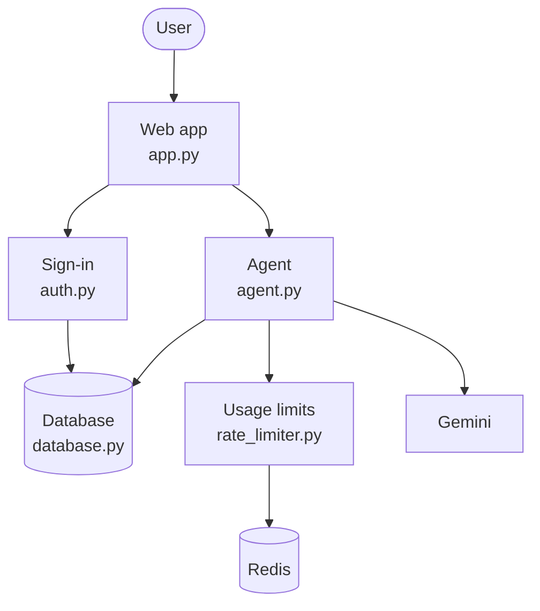
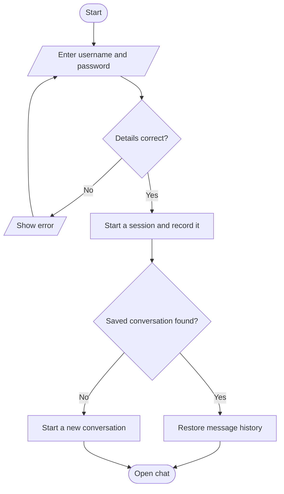
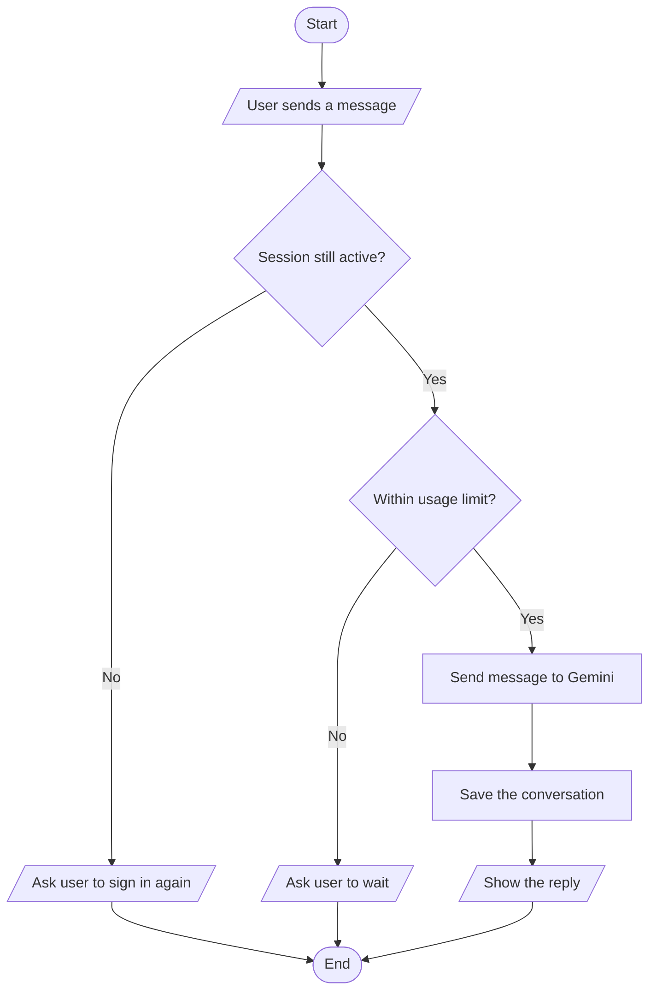

# Multi-Session Agent

> **Archived project.** This is an old project . It is kept here for reference only and may not work with current versions of its dependencies.

A small chat app built with Streamlit and Google Gemini. Each user signs in, chats with an AI agent, and can pick up where they left off, even after the app restarts.

It was built as a hands-on exercise covering the topics below.

| Topic | Where to look |
|---|---|
| Sign-in and permissions | `auth.py`, `database.py` |
| Keeping keys and secrets out of the code | `config.py`, `.env` |
| Usage limits | `rate_limiter.py` |
| Saving and restoring conversations | `database.py`, `agent.py` |
| Running slow tasks in the background | `agent.py` |

## How it works

### Overview



All settings and keys are loaded from `.env` by `config.py`.

### Signing in



### Sending a message



## Running locally

```bash
pip install -r requirements.txt
cp .env.example .env        # then add JWT_SECRET and GEMINI_API_KEY
streamlit run app.py
```

Redis is optional. Without it, the app uses a simple in-memory limiter and notes this in the sidebar. To test with Redis, start it first with `docker run -p 6379:6379 redis`.

## Design notes

- Each sign-in is recorded in the database, so a session can be ended at any time, for example on logout, instead of staying valid until it expires.
- Slow work, such as database and Gemini calls, runs in the background so the app stays responsive.
- Usage limits are counted per user, not per IP address or across the whole app.
- The conversation is saved after every message. If the app stops partway through, signing back in restores the full history.

## Building on it

- To use Postgres, set `DATABASE_URL` in `.env` and uncomment the `psycopg` line in `requirements.txt`. No code changes are needed.
- To load secrets from a vault instead of `.env`, only `config.py` needs to change, since every other file reads its settings from there.
- To use a hosted Redis server, set `REDIS_URL` to its address.

## Not included

- Outside triggers such as webhooks. The agent only responds to messages sent from the app.
- User roles. Every user has the same permissions and can only see their own data.
- Staying signed in after a browser refresh. Users sign in again, and their conversation is restored from the database.